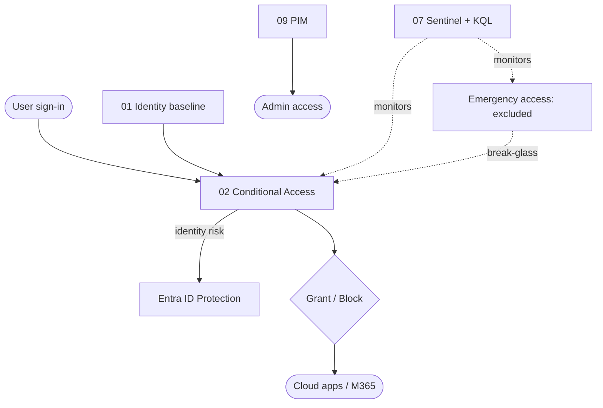

# Entra Zero Trust Identity Baseline

[](https://developer.hashicorp.com/terraform)  [](LICENSE) 

I've worked in identity for five years, and I keep seeing the same thing: someone does some click-ops in the portal to change something, and then it's completely forgotten. When that tech leaves, no one knows what happened, or how it relates to the next change.

So I built my Entra security baseline in Terraform. Every control is code, every change shows up in a plan before it touches the tenant, and every decision has a written reason.

**[See it working: What If results, test sign-ins, Sentinel alerts →](docs/screenshots.md)**

## What I built

**1. Conditional Access as code.** Four policies rendered from one reusable Terraform module: block legacy auth, MFA for everyone, block high-risk sign-ins, and remediate high user risk. The module refuses to plan a policy that would block all users with no exclusion, so the classic lock-yourself-out mistake fails before it ships.

**2. Break-glass accounts.** Two passkey-protected Global Admin accounts, excluded from every policy through two separate exclusion groups. They're created first in a staged bootstrap, and you have to sign in with both before any policy is switched on. `prevent_destroy` stops Terraform from deleting them.

**3. PIM for admin access.** Just-in-time Conditional Access Administrator: eligible by default, one-hour activation, justification required. I set this up in the portal and tested activation through to expiry on a test admin.

**4. Sentinel detections as code.** A Log Analytics workspace, Entra log export and three analytics rules, all in Terraform: alert on any emergency-account sign-in, alert on any change to the exclusion groups, and a tenant-wide password-spray indicator. The first two fired on real events in the lab.

## How it's built

- Two Terraform roots with separate state: [identity](terraform/) (`azuread`) and [detections](terraform/detections/) (`azurerm`).
- [CI on both roots](.github/workflows/terraform.yml): `fmt -check`, `init -backend=false` and `validate`, with Terraform pinned to 1.15.7.
- [Guardrails in the CA module](terraform/modules/conditional-access-policy/main.tf) and [`prevent_destroy` on the emergency accounts](terraform/break-glass.tf).
- A [staged deployment](#deploy-it-yourself) that builds the recovery path before any enforcement.
- [Six decision records](docs/adr/), each with the alternatives I considered.



## Control status

| Control | How it's managed | Tested |
|---|---|---|
| CA001 Block legacy authentication | Terraform | What If |
| CA002 Require MFA for all users | Terraform | Live sign-in |
| CA003 Block high-risk sign-ins | Terraform | What If |
| CA004 Remediate high user risk | Terraform, report-only | What If |
| Emergency accounts and exclusion groups | Terraform (passkeys in portal) | Live sign-in, What If |
| PIM for Conditional Access Administrator | Portal | Live activation |
| Sentinel: emergency-account sign-in | Terraform | Fired on a real sign-in |
| Sentinel: exclusion group change | Terraform | Fired on a canary test and a real change |
| Sentinel: password-spray indicator | Terraform | Query runs; no spray in the lab to fire it |

Full detail, with dates, is in the [evidence index](docs/screenshots.md#control-evidence-index).

## What I left out, and why

Device management (Intune, Autopilot, update rings, Defender for Endpoint) was in the original plan. I dropped it on purpose. Intune lives in Microsoft Graph, the provider I'd planned to use only talks to Azure Resource Manager, and the Graph-based alternatives were preview or community-maintained. The lab also had no devices to test against. The design notes are in [docs/out-of-scope](docs/out-of-scope/device-management.md), and the full reasoning is in [ADR-006](docs/adr/adr-006-device-management-out-of-scope.md).

## Deploy it yourself

> This is a lab bootstrap for a disposable tenant. Don't run it against a tenant anyone depends on.

**You'll need:** Terraform 1.7 or later, Azure CLI, a disposable Entra tenant with Entra ID P2, and an Azure subscription for the detections root.

**Why it's staged.** One `terraform apply` would create the emergency accounts and switch on Conditional Access in the same run. At that moment the emergency accounts have no passkeys yet, so MFA could be enforced on everyone before anyone can get back in. The stages below make the way back in real before enforcement starts. Every stage plans to a file and applies that file, so the plan you reviewed is the plan that ran.

```bash
az login --tenant <your-tenant-id>
cd terraform
terraform init
```

**Stage 1: emergency access only.** `-target` is meant for exceptions, and building the recovery path first is one.

```bash
terraform plan -out stage1.tfplan \
  -target=azuread_directory_role_assignment.break_glass_global_administrator \
  -target=azuread_group.break_glass_exclude \
  -target=azuread_group.break_glass_exclude_role_assignable
terraform apply stage1.tfplan
```

Check in the portal: both accounts exist, both exclusion groups contain both accounts, and both accounts hold active Global Admin.

**Stage 2: passkeys.** Register a separate passkey on each account, then sign in as each one in a private window and reach the admin centre. Don't go further until both have signed in. An emergency account that has never signed in is an untested control.

**Stage 3: your own account.** Make sure the account you deploy with is registered for MFA. CA002 covers you too.

**Stage 4: turn off Security Defaults** in the portal (Properties, Manage security defaults). The azuread 2.x provider can't manage this setting. Move straight to stage 5.

**Stage 5: Conditional Access.**

```bash
terraform plan -out stage5.tfplan
terraform apply stage5.tfplan
```

Then open each policy, confirm both exclusion groups are excluded, and run What If for an emergency account. No policy should apply.

**Stage 6: detections** (separate state).

```bash
cd detections
terraform init && terraform plan -out tfplan && terraform apply tfplan
```

**If you lock yourself out,** sign in with an emergency account, turn the policy off in the portal, then fix it in code. If you only fix it in the portal, the next apply will undo your fix.

## Limits and what I'd do next

- State is local, one file per root. Next: remote state with locking.
- CI checks formatting and validity but doesn't plan or apply. Next: OIDC workload identity so CI can run `plan` on every pull request, with a reviewer approving before `apply`.
- PIM is configured in the portal. Next: PIM as code.
- My deploying admin account held standing Global Admin as a lab shortcut. Next: move it to PIM.
- Next in CI: TFLint and an IaC security scanner, and the azuread v3 provider.

More detail is in [assumptions and limitations](docs/assumptions-limitations.md), the [architecture notes](docs/architecture.md) and the [threat model](docs/threat-model.md).

## Status of the lab

I ran this lab from July to August 2026 on trial Entra ID P2 licences. It's now shut down.

## Related work

[manage-user-loa](https://github.com/Dhanzz1/manage-user-loa) is a PowerShell module I built for leave-of-absence automation in hybrid AD and Exchange Online. It's separate from this repo; the cloud joiner, mover and leaver design in [docs/out-of-scope](docs/out-of-scope/cloud-lifecycle.md) isn't built yet.

## Security

No secrets or Terraform state are in this repo. State, `*.tfvars` and plan files are gitignored. What's redacted in the screenshots, and what's left visible on purpose, is listed in the [redaction notes](docs/screenshots.md#redaction-notes).

## License

MIT. See [LICENSE](LICENSE).
